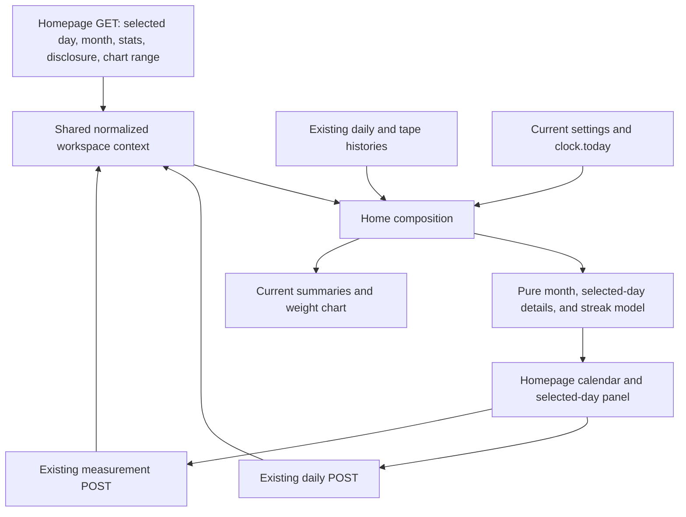

# Calendar logging completeness - Plan

## Goal Capsule

- **Objective:** See current progress, log a day, and find gaps to correct from the home dashboard.
- **Means:** A homepage month calendar connected to one selected-day editor, with selectable values and separate current streaks (KTD1–KTD6).
- **Authority:** The Product Contract owns behavior; the Planning Contract owns implementation choices. `AGENTS.md` and `docs/testing.md` govern implementation and validation.
- **Execution profile:** Four dependent units, delivered on one feature branch when implementation is authorized.
- **Handoff:** This document authorizes planning only. Implementation, commits, and publication require a subsequent instruction.
- **Stop conditions:** Report a need for new stored data, changed calculation rules, or replacement of existing write protections before expanding scope.

---

## Product Contract

### Summary

Make the homepage a dashboard with current summaries above a calendar and selected-day logging workspace.
Today is selected and ready for entry on arrival; choosing another date loads its records into the same editor.
Preserve the calendar context during saves and error recovery, and show independent weight and calorie streaks.

### Problem Frame

The dashboard and History show saved daily entries, but absent dates are difficult to inspect.
A separate calendar page would require moving between reviewing gaps and correcting them.
The home page already contains daily and measurement forms, and the user wants the information and actions needed for the daily routine together.
Weight and calories can be recorded independently, so their consistency needs separate streaks.

### Key Decisions

- **Homepage dashboard and connected logging workspace.** Keep reviewing and correcting a day together. Governs R1, R7, R12–R16. (session-settled: user-approved — chosen over a separate calendar page and detached quick-entry form: user accepted one selected-day editor beside or below the calendar, ready for today by default.)
- **Dedicated inputs for the selected day.** Keep the month scannable and reuse existing form behavior. Governs R7, R13, R15. (session-settled: user-approved — chosen over editable inputs in every calendar cell or duplicate logging forms: user accepted a single editor connected to day selection.)
- **Separate weight and calorie streaks.** Reflect independent logging habits. Governs R8, R9. (session-settled: user-directed — chosen over a combined streak or displaying both kinds: user selected separate streaks after reviewing those options.)
- **Selectable actual values alongside completeness.** A status-only calendar would omit the daily statistics requested by the user. Governs R2–R4.
- **Proceed with P2.2 while P2.1 remains partial.** Existing tape sessions supply the required measurement data. Governs R10.

### Requirements

**Calendar and values**

- R1. The calendar lives on `/` as part of the home logging workspace. It uses Monday–Sunday weeks, previous/next month links, a month picker, and a Today action; a fresh visit selects today and displays its month without an extra click.
- R2. Labeled checkboxes select weight, calories, the tape sites available in the current measurement form, and the Navy estimate. Weight and calories are selected by default; unavailable profile settings link to Settings without blocking daily logging.
- R3. On desktop, selected recorded stats show a check mark, value, and unit in their day cell. On mobile, cells retain compact presence indicators and the selected day's values appear below the month; tape values are session means, and Navy percentages are labeled as calculated estimates rather than recorded results.
- R4. Unknown values remain distinguishable from zero, and measurements or estimates are never carried into another date. Selected missing readings use an unavailable label; a session without a usable Navy estimate shows the existing reason in its selected-day details.
- R5. Measurement-session markers remain visible independently of the selected stats and of whether the session can produce an estimate. Tape-stat choices follow the existing sex-specific form, and readings at hidden sites remain stored without being offered as editable calendar fields.

**Completeness and editing**

- R6. Each applicable date distinguishes weight only, calories only, both, or neither using words or labeled symbols as well as color. Missing-log classification starts on the earliest date with a saved weight or calorie value; earlier dates, future dates, and an empty daily history are not missed logs. Today is marked in progress when either daily value is absent.
- R7. A month-scoped incomplete-days list names past dates on or after that tracking start which lack weight, calories, or both. A date in the month or gap list selects that day in the homepage editor; a session marker selects its date and opens Measurements in that editor. Past dates before tracking started support backfill; future dates remain visible but cannot be selected for logging.

**Streaks**

- R8. Show two current streaks: consecutive calendar dates with recorded weight, and consecutive calendar dates with recorded calories. A calorie total of zero counts; measurements, estimates, and visible-stat choices do not affect either streak.
- R9. For each stat independently, count backward from today when recorded, otherwise from yesterday. A missing anchor yields zero; an unfinished today preserves a run through yesterday. Streaks use record dates, span month/year boundaries, and recompute after backfills, corrections, clearing a field, or deletion. They always describe the current run as of today, with the last counted date for a nonzero run.

**Dashboard, selection, and forms**

- R10. P2.2 uses existing daily entries and tape sessions. External body-fat results (P2.1 B) and optional context/polish (P2.1 C) remain pending; optional measurement cadence never makes an unmeasured date incomplete.
- R11. Calendar navigation, checkbox application, day selection, both forms, and recovery links work without JavaScript. Calendar stat selection survives navigation and reloads, including an explicit selection of no stats.
- R12. Wide screens place the selected-day editor beside the month; narrow screens place it directly below a compact seven-column month with no horizontal page overflow. Current display units, existing precision, visible keyboard focus, selected-day indication, and labels independent of color apply in both layouts.
- R13. The homepage has one selected logging date and one daily weight/calorie form, with an expandable measurement form for that same date. Daily inputs are ready for today on a fresh visit; selecting another day loads saved values or blanks and clearly identifies the date being edited.
- R14. Month browsing and stat selection preserve the selected day; selecting a day directly or with the shared date picker displays its month. Today resets both day and month. Daily and measurement saves, validation errors, stale-state recovery, measurement disclosure links, and chart-range changes retain the month, selected stats, and selected day unless an explicit date-selection action changes it.
- R15. Daily and measurement submissions remain independent: each writes only its own record type through its existing endpoint and guards. Invalid input stays visible in its form, stale-unit handling refreshes values under existing rules, and feedback opens or focuses the affected editor. Navigation loads saved records and never autosaves either form.
- R16. Current summaries sit above the logging workspace, with the longer-range weight chart below. Today's target, TDEE, trend, and latest dated measurement summary remain current while editing an older day; moving the editor must not duplicate it or change calculation inputs. A fresh visit starts at those summaries without autofocus scrolling past them; explicit day selection and form feedback may target the editor.

### Acceptance Examples

| ID | Given / action | Expected result | Covers |
| --- | --- | --- | --- |
| AE1 | Today is 16 Oct 2026; the first daily entry is weight only on 12 Oct; 13 Oct has calories `0`; 14 Oct has both; 15 Oct has no entry. | The four dates show weight only, calories only, both, and neither respectively. The gap list contains 12, 13, and 15 Oct with missing fields named. 11 Oct is before tracking; 16 Oct is in progress and outside the past-gap list. | R4, R6, R7 |
| AE2 | Weights exist on 13–15 Oct; calories on 14–16 Oct; today is 16 Oct. | Weight streak is 3 through 15 Oct; calorie streak is 3 through 16 Oct. Month, selected-day, and stat changes do not change either current streak. | R8, R9 |
| AE3 | AE2's records remain; the date advances to 17 Oct without further logging. | Weight streak becomes 0 because 16 Oct lacks weight; calorie streak remains 3 through 16 Oct. Logging weight on 17 Oct begins a one-day weight run. | R9 |
| AE4 | A usable tape estimate exists on 10 Oct and a neck-only session on 15 Oct, with no daily entries. | Both dates have markers. Selecting 15 Oct shows its neck mean and missing-site reason, without borrowing the 10 Oct estimate. No daily gaps exist and both streaks are 0. | R4–R8, R10 |
| AE5 | Clear and apply all stat checkboxes, then browse to the next month. | Numeric calendar rows stay hidden with a selection message. Presence states, session markers, day selection, editor inputs, and streaks remain available. | R2, R5, R7, R8, R11 |
| AE6 | On `/`, browse September, select 12 Sep, enable Neck, and correct its calories. | The same homepage returns with September, 12 Sep, and the chosen stats retained. The day and current streaks reflect the correction; today's target remains today's target. | R13–R16 |
| AE7 | With 12 Sep selected, browse October, then choose Today. | Browsing alone keeps the editor on 12 Sep with its date explicit. Today then selects 16 Oct and displays October. | R1, R13, R14 |
| AE8 | Submit invalid measurements for the selected day, then trigger a stale daily-form conflict separately. | Each error appears in its affected form with the calendar context retained. Neither rejected submission changes stored data or silently selects another day. | R14, R15 |
| AE9 | On a 375px viewport with JavaScript disabled, select 12 Oct. | The compact month marks 12 Oct as selected; its selected-stat values and the existing editor appear underneath. The form saves through native navigation without horizontal page scrolling. | R3, R11–R15 |

### Scope Boundaries

Use a fixed catalog of existing measurements and daily values.
Historical TDEE, calorie-target, and projection snapshots are outside the calendar; the current dashboard and chart retain their existing meanings.

Reuse the daily and measurement write endpoints.
A single selected-day workspace contains two independently submitted forms, not a combined transaction or a second quick-entry form elsewhere.
Do not add in-cell inputs, stored completeness flags, persisted streak counters, or a new calendar route.

No autosave, draft persistence, or custom unsaved-change recovery is added.
Date or view navigation loads stored records through native requests; draft recovery can be revisited if actual use warrants it.

#### Deferred to Follow-Up Work

- P2.1 B: manually recorded external body-fat results and separate method histories.
- P2.1 C: optional ratios, BMI, estimate charts, and measurement seed-data expansion.
- P2.3: period statistics, monthly coverage summaries, longest/lifetime streaks, and comparisons.
- P2.4/P2.7: phases, notes, activity, and experiment markers when those records exist.
- Persistent preferences across fresh homepage visits and browsing hidden historical tape sites outside the current form's profile.

**Product Contract revision:** R1–R3, R5, R7, R11, and R12 now describe the homepage workspace and current-profile fields; R13–R16 add its shared selection, state retention, independent saves, and summary layout.
R4, R6, R8–R10 retain their meaning.
AE1–AE5 retain their original behaviors with homepage selection in place of separate-editor navigation; AE6–AE9 cover the revised workflow.

---

## Planning Contract

### Existing Architecture and Dependencies

- `src/tdee_calculator/routes/today.py` already composes the dashboard, chart, daily form, and home measurement form in `render_home`. Reuse its complete-history daily and measurement reads instead of querying the same history again.
- `src/tdee_calculator/templates/index.html` currently places the daily form near the target and a separate expandable measurement form below. Move those existing form instances into the selected-day workspace.
- `src/tdee_calculator/routes/measurement_context.py` owns reusable measurement form values, profile-specific sites, links, and destination context. The existing home destination is the starting point for preserving workspace state.
- `src/tdee_calculator/routes/measurements.py` already renders home on measurement failure and redirects home on success when invoked from home. Keep standalone `/measurements` behavior intact.
- `src/tdee_calculator/body_fat.py` provides means, usable estimates, and unavailable reasons. `src/tdee_calculator/entries.py` provides all daily logs, while `src/tdee_calculator/measurements.py` eagerly loads sessions and readings.
- `src/tdee_calculator/static/date-selector.js` coordinates the existing date loader with the daily form. Its element and form assumptions need checking when the date control moves.
- `tests/test_home_measurement_routes.py` currently tests independent daily and measurement dates on home. R13 intentionally replaces that presentation contract with one workspace date; independent persistence and standalone behavior remain required.

P2.1 A and A2 supply the prerequisites.
No dependency, migration, schema, or estimator change is expected.

### Key Technical Decisions

- KTD1. **Compose on the existing home route.** Add pure month/streak behavior in `src/tdee_calculator/logging_calendar.py` and call it from `src/tdee_calculator/routes/today.py`. Render a new `src/tdee_calculator/templates/_calendar.html` partial inside the home page. R1 and R16 replace the earlier separate-page design.
- KTD2. **One normalized workspace context.** A small typed view state carries selected date, visible month, stat IDs, and measurement disclosure; chart range remains its own existing value. A shared `src/tdee_calculator/routes/calendar_context.py` builds homepage URLs and form context for both save routes, per R14, without a second redirect protocol.
- KTD3. **Reuse full-history reads and compose only the month.** Derive tracking start and current streaks from the daily logs already loaded by home. Index dates, build cells only for the requested month, and reuse `body_fat.build_row` for its sessions. Avoid per-cell queries and expanding the full tracking interval into daily cells.
- KTD4. **Derive streaks from field presence.** Build a date set for each daily stat and use R9's anchor rule with explicit `None` checks. R8's independent streaks need no stored counters.
- KTD5. **Native controls and responsive presentation.** Use an accessible seven-column month table with blank padding cells and ordinary day-selection links. Render the selected date's stat details once in the editor panel; desktop cells additionally show R3's selected values. Native GET/POST forms are sufficient; JavaScript only enhances interaction.
- KTD6. **Reuse the existing two forms in one workspace.** Place the current daily form and expandable measurement form in the selected-day panel. Apply R13–R15 through existing parsing, overwrite/version guards, conditional writes, and home failure rendering. Home measurements use the shared selected day; standalone measurements retain their editable date control.
- KTD7. **Explicit, bounded URL state.** Keep `date` for the selected day and `range` for chart range; add strict `YYYY-MM` `month`, repeated allowlisted `stat` values, and a hidden `selection=1` marker for an explicit empty selection. Missing month defaults to the selected day's month; malformed values use existing date/range normalization or that month default. Unknown stat IDs are ignored, duplicates removed, and sites outside the current profile dropped.
- KTD8. **Normalize existing home measurement links at the boundary.** Generate new links using the shared selected date and disclosure state. Existing `circumference_date` links select that measurement date and open its form; normalize them to the single workspace date before rendering. An invalid or future legacy date uses the existing safe requested-day rules. Standalone measurement links and submissions retain their destination.

KTD2 and KTD7 own display state only.
Hidden form fields carry that normalized context through POSTs; they grant no permission to change the submitted record date or bypass validation.
Read repeated stat values before the single-value `FormDependency` mapping would collapse them, for both GET controls and POST context.
Construct homepage links from allowlisted state rather than accepting arbitrary return URLs.

### Homepage Layout

1. **Current snapshot:** existing target, TDEE, trend/goal, and latest dated measurement summary.
2. **Logging workspace:** current streaks and collapsible stat controls above the month, with the selected-day editor beside it on wide screens and below on narrow screens.
3. **Progress:** existing weight chart, range controls, and optional table fallback.

Keep today's target prominent and measurement dates explicit.
The latest-measurement summary retains its independent latest-session/latest-usable-estimate dates and cadence.
Its Log/Edit latest actions select the intended workspace day and open Measurements; it contains no second form instance.

### High-Level Technical Design

The daily presence states remain independent of visible stats and measurement markers:

| Weight present | Calories present | Presence state |
| --- | --- | --- |
| No | No | Neither |
| Yes | No | Weight only |
| No | Yes | Calories only |
| Yes | Yes | Both |

Workspace transitions implement R13 and R14:

| Action | Selected day | Visible month | Other view state |
| --- | --- | --- | --- |
| Fresh homepage | Today | Today's month | Default stats; measurements closed |
| Previous/next month or month picker | Preserved | Requested month | Preserved |
| Select day or shared date picker | Chosen date | Chosen date's month | Preserved |
| Select session marker | Session date | Session date's month | Measurements open |
| Today | Today | Today's month | Preserve stats and chart range |
| Apply stat choices | Preserved | Preserved | Apply choices, including none |
| Change chart range | Preserved | Preserved | Apply range |
| Save, validation error, or stale-state recovery | Submitted form's day remains explicit | Preserved | Preserve stats, range, and affected-form feedback |

### Implementation Constraints

Capture the request's current date through `clock.today()` and pass it into calendar logic.
Keep `src/tdee_calculator/calc.py` standard-library-only and unchanged unless implementation establishes a necessary correction.
Store and calculate in canonical kg/kcal/cm; use existing display precision and formatters.
Navy estimates keep the current-sex/current-height behavior and explanatory note.

An offscreen selected day remains labeled in the editor while browsing other months.
Calendar controls never submit either data form.
For homepage forms, the shared date picker chooses the record date before entry; each POST still carries its own loaded date/version and record date for validation.
Do not silently replace a POST's record date with today's date when restoring view context.

Keep snapshot calculations independent of selected date and month.
Minimum/maximum supported months must avoid out-of-range neighbor arithmetic.

### Sequencing and References

U1 establishes the pure calendar model; U2 carries workspace state through the existing request and save boundaries; U3 assembles the responsive homepage; U4 verifies the integrated workflow.
Exact helper names, breakpoint values, and minor copy belong to implementation.

The prior home-measurement plan, `docs/plans/2026-10-10-001-feat-home-measurements-weekly-cadence-plan.md`, remains the reference for measurement persistence and estimates.
R13 deliberately supersedes its independently selected home-form dates and original form placement.
Its standalone measurement page, raw-data preservation, and write protections remain applicable.

---

## Implementation Units

### U1. Calendar values, completeness, and streak model

**Goal:** Produce month cells, selected-day values, missing-day classification, and current streaks without HTTP or database access.

**Requirements:** R2–R10, R12–R14; AE1–AE5. **Dependencies:** None.

**Files:** New `src/tdee_calculator/logging_calendar.py` and `tests/test_logging_calendar.py`; reuse `src/tdee_calculator/body_fat.py`, `src/tdee_calculator/calc.py`, and `src/tdee_calculator/units.py`.

**Approach:** Implement KTD3–KTD5 with typed view models and a fixed stat catalog.
Represent date eligibility separately from presence and selection.
Selected-day details are available even when its date is outside the visible month.

**Patterns:** Pure passed-in-date view models in `src/tdee_calculator/measurement_dashboard.py` and existing measurement reasons in `src/tdee_calculator/body_fat.py`.

**Test scenarios:**

1. Covers AE1. Assert all four presence states, exact tracking start, and the incomplete-date list against fixed records.
2. Empty daily history, measurement-only history, and a defensive both-null row produce no tracking start or daily gaps.
3. Covers AE2 and AE3. Enumerate expected streaks across today/yesterday anchors, missing anchors, month/year boundaries, and leap day.
4. Backfilling a gap joins a run; clearing only weight changes only its run; deletion recomputes presence and tracking start.
5. Covers AE4. Complete, partial, missing-settings, and out-of-range tape sessions reuse independently established answers from `tests/test_body_fat.py`.
6. Current-profile site selection hides uneditable options without changing stored readings. Missing sex still permits daily values and session markers.
7. Covers AE5. Empty stat selection does not remove status, markers, editor records, or streaks.
8. February 2028 includes leap day; leading/trailing padding is blank; supported date boundaries have safe neighboring-month availability.
9. An offscreen selected date retains its own values, and selected-date changes never recalculate today's snapshot or current streak anchor.

**Verification:** Fixed-date unit expectations establish R6/R9 behavior without reading the clock or real data.

### U2. Homepage selection and save-context integration

**Goal:** Keep one selected day and preserve the workspace through native navigation, saving, and error recovery.

**Requirements:** R1, R7, R11, R13–R15; AE6–AE8. **Dependencies:** U1.

**Files:** New `src/tdee_calculator/routes/calendar_context.py` and `tests/test_calendar_home_routes.py`; update `src/tdee_calculator/routes/today.py`, `src/tdee_calculator/routes/measurements.py`, `src/tdee_calculator/routes/measurement_context.py`, `src/tdee_calculator/templates/_log_form.html`, `src/tdee_calculator/templates/_measurement_form.html`, and `tests/test_home_measurement_routes.py`.

**Approach:**

1. Establish KTD2/KTD7's state normalization and homepage URL generation, applying KTD8 at the legacy-link boundary.
2. Compose the calendar from home's existing history reads and load both form records for R13's selected day.
3. Carry normalized display state through daily and home-measurement success, validation failure, stale-setting refresh, and conflict/reload paths.
4. Update the existing home-specific date expectations explicitly; keep independent writes and standalone measurement contracts covered.

**Patterns:** Existing home measurement destination handling and real-database route fixtures.

**Test scenarios:**

1. A fresh home request loads today in both forms, including blank records; a direct past-date link loads that day's existing values and versions.
2. Missing, malformed, and future dates use safe GET normalization. Invalid months, repeated/unknown stat IDs, and explicit empty selections behave per KTD7 without arbitrary redirects.
3. Covers AE7. Follow generated month, date-picker, day, marker, and Today URLs; assert each transition's selected day, month, stats, and disclosure.
4. Covers AE6. Submit a correction, follow the actual redirect, and assert preserved September/12 Sep/stat selection and updated stored values, cell state, and streak.
5. Covers AE8. Exercise 422, stale units, stale sex, overwritten/deleted records, and competing writes through real save boundaries. Follow generated recovery links and assert preserved workspace state and the existing rejection semantics.
6. Measurement writes leave daily records unchanged, daily writes leave tape readings unchanged, and unchanged edits retain stored precision.
7. Old `circumference_date` links normalize to one explicitly selected workspace day; standalone `/measurements` submissions still render and redirect there.
8. Chart-range and measurement open/close links preserve selected day, month, and stat selection. All GET interactions leave record values and timestamps unchanged.
9. A run spanning more than 30 records proves full-history streaks and old-month cells do not use the recent-history limit.

**Verification:** Assertions follow real rendered links, native form fields, and redirects instead of manually reconstructing a return URL.

### U3. Responsive dashboard and selected-day editor

**Goal:** Present current summaries, calendar selection, and one ready-to-use editor on the homepage.

**Requirements:** R1–R5, R7, R11–R16; AE5, AE9. **Dependencies:** U2.

**Files:** New `src/tdee_calculator/templates/_calendar.html`; update `src/tdee_calculator/templates/index.html`, `src/tdee_calculator/templates/_log_form.html`, `src/tdee_calculator/templates/_measurement_form.html`, `src/tdee_calculator/templates/_measurement_summary.html`, `src/tdee_calculator/templates/_chart.html`, `src/tdee_calculator/static/style.css`, `src/tdee_calculator/static/date-selector.js` if its assumptions change, and `tests/test_calendar_home_routes.py`.

**Approach:**

1. Implement the Homepage Layout using existing summary components and their current calculation context.
2. Move the existing forms into the selected-day panel; use one shared date-loader control with an explicit native submit button, retaining each data form's own hidden date/version.
3. Put expandable stat controls and dated current-streak labels above the calendar; show selected-day details and measurement feedback in the panel.
4. Use responsive CSS to move the same editor and details below the compact mobile month, without rendering duplicate forms or separate mobile controls.
5. Review the relocated daily input's existing autofocus against R16: initial arrival must expose the dashboard summary, while explicit selection and errors direct attention to the editor.

**Patterns:** Existing CSS tokens, native disclosures, focus styling, and shared measurement template. Keep the chart's accessible table fallback.

**Test scenarios:**

1. The response contains exactly one daily form and one home measurement form, with explicit selected-date labeling and no duplicate field IDs.
2. Controls have labels/legends, table headers name weekdays, today and selected day are distinct, and stat visibility does not alter editor inputs.
3. Default rendering keeps daily inputs ready. A session marker opens Measurements for that day; its errors remain visible and discoverable after submission.
4. With a past selected day, target/TDEE/trend values remain equal to the same request for today, while editor records reflect the selected day.
5. Covers AE9. Native controls remain usable with JavaScript disabled; desktop/mobile behavior is verified through the browser checklist.
6. Measurement summary actions use the shared workspace, retain latest-session/latest-usable-estimate dates, and no longer include a second form instance.
7. If `src/tdee_calculator/static/date-selector.js` changes, verify that selecting a date loads records before saving and restores consistent controls after browser Back.

**Verification:** Route tests cover significant structure and data; actual desktop/mobile, focus, and no-JavaScript behavior have browser evidence.

### U4. Integrated dashboard workflow and documentation

**Goal:** Verify fast daily entry and historical corrections from the dashboard, then document the resulting behavior.

**Requirements:** R6–R16; AE1–AE9. **Dependencies:** U3.

**Files:** `tests/test_calendar_home_routes.py`, `tests/test_home_measurement_routes.py`, `README.md`, `docs/roadmap.md`, `docs/plans/p2-1-measurements.md`, and this plan if implementation reveals a material correction.

**Approach:** Exercise the workspace through its actual controls and forms; verify both mutation isolation and display-state retention.
Document the homepage layout, shared selected day, stat choices, streak anchors, and pending P2.1 B/C scope.

**Test scenarios:**

1. Arrive on home and save today's weight without selecting a calendar day; then save its calories without losing the weight.
2. Find a historical gap, select it, submit its missing value, and follow the response to the same month/day/stat selection with the gap corrected.
3. Clear a field and delete a record through existing supported actions; a fresh home request reflects changed completeness and streaks. Deletion need not gain a new workspace control.
4. Select a tape session, expand its existing form, correct it, and verify calendar details and latest-measurement summary update without changing daily logs or dashboard calculation inputs.
5. Change month, selected stats, chart range, and measurement disclosure independently, asserting R14's transitions and empty states.
6. Revisit stale-version, stale-unit, and stale-sex recovery within the shared workspace without weakening the established standalone editor behavior.

**Verification:** The complete project gate and browser checklist pass, documentation matches observed behavior, and no application code outside the planned feature remains in the diff.

---

## Verification Contract

Follow `docs/testing.md`: pure fixed-date tests for U1, real temporary SQLite and `TestClient` for U2/U4, and focused browser checks for U3.
Use the existing independent Navy fixtures rather than recopying the equation into new tests.

| Gate | Required evidence |
| --- | --- |
| Complete project checks | `./check.sh` passes formatting, Ruff lint, strict mypy, pyright, and full tests with branch coverage; do not lower the threshold. |
| Data isolation | Automated databases use `tmp_path`; every manual run uses a temporary `TDEE_DATA_DIR`. Never inspect or change real `data/`. |
| Desktop and mobile | At 1280px, verify calendar/editor adjacency and readable selected values; at 375px, verify the compact full-width month with details/editor below, no horizontal page scrolling, and no duplicated forms. Check light/dark appearance. |
| Native interaction | With JavaScript disabled, log today immediately, apply stat choices, browse months, select/backfill a day, expand Measurements, save, and recover from errors while retaining view state. |
| Focus and feedback | A fresh visit starts at the current summaries without an autofocus scroll jump. Keyboard access reaches each control; selected day and today have distinct labels; selecting a day targets the editor. Validation and saved/conflict feedback remain visible, including measurement errors inside the disclosure. |
| Dashboard regression | Past-day selection and month browsing do not change today's target, TDEE, chart range, or latest-measurement dates except when actual saved data changes. |
| Write safety | Both POST endpoints retain guards and precision; daily and measurement records remain independent. Standalone history, measurement, and settings workflows remain usable. |

No new browser-automation framework or client-side state store is required.
If new JavaScript owns behavior beyond the existing date-loader enhancement, add focused behavioral automation under `docs/testing.md` rather than relying only on markup tests.
Record actual feature verification during implementation; this plan does not claim it has run.

---

## Definition of Done

- R1–R16 and AE1–AE9 hold in the homepage workspace.
- U1–U4 have their stated evidence and the complete project quality gate passes.
- Today's default entry and historical correction workflows pass at desktop/mobile sizes and without JavaScript.
- Exactly one daily form and one expandable measurement form serve the homepage selected day; no standalone calendar page or in-cell editor is added.
- Current dashboard summaries retain their meaning while calendar, selected-day, and chart controls follow the documented transitions.
- The final diff has no abandoned prototypes, unnecessary dependencies, stored derived counters, or unrelated cleanup.
- Documentation reflects the homepage design and leaves P2.1 B/C pending.
- Implementation and Git/PR publication are reported separately; commits and publication follow explicit authorization.
